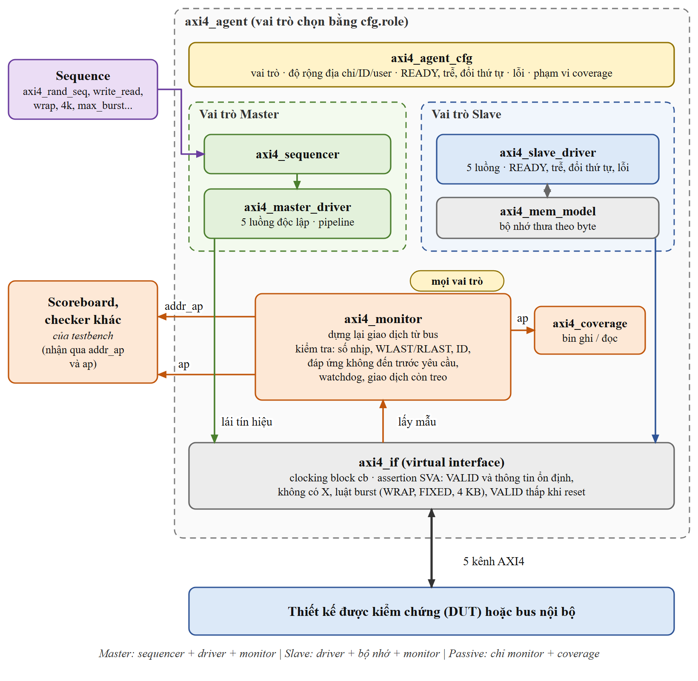
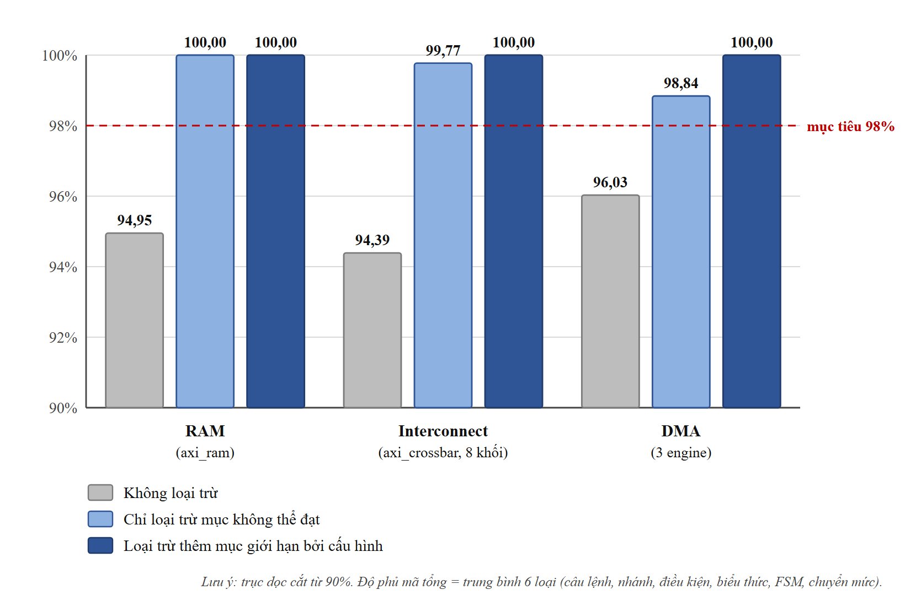
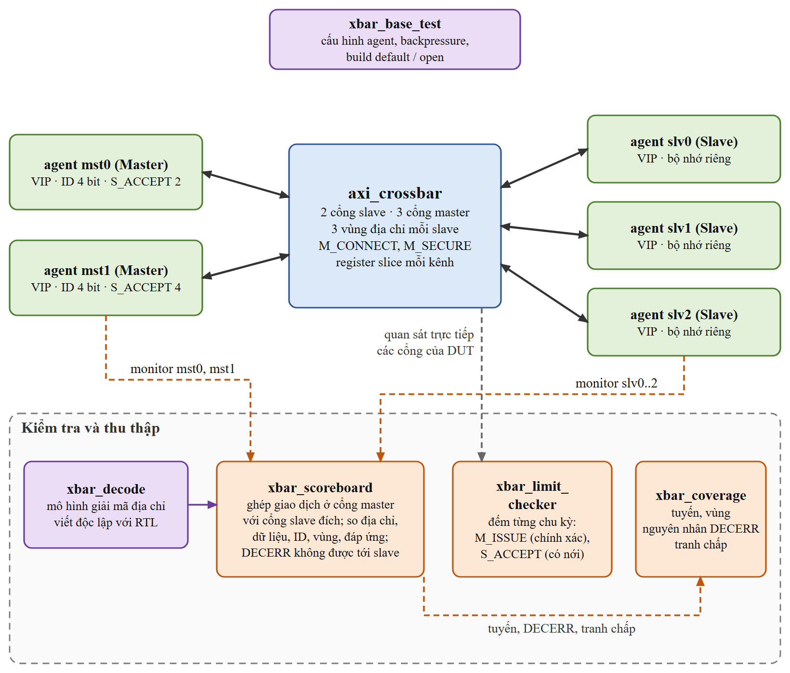
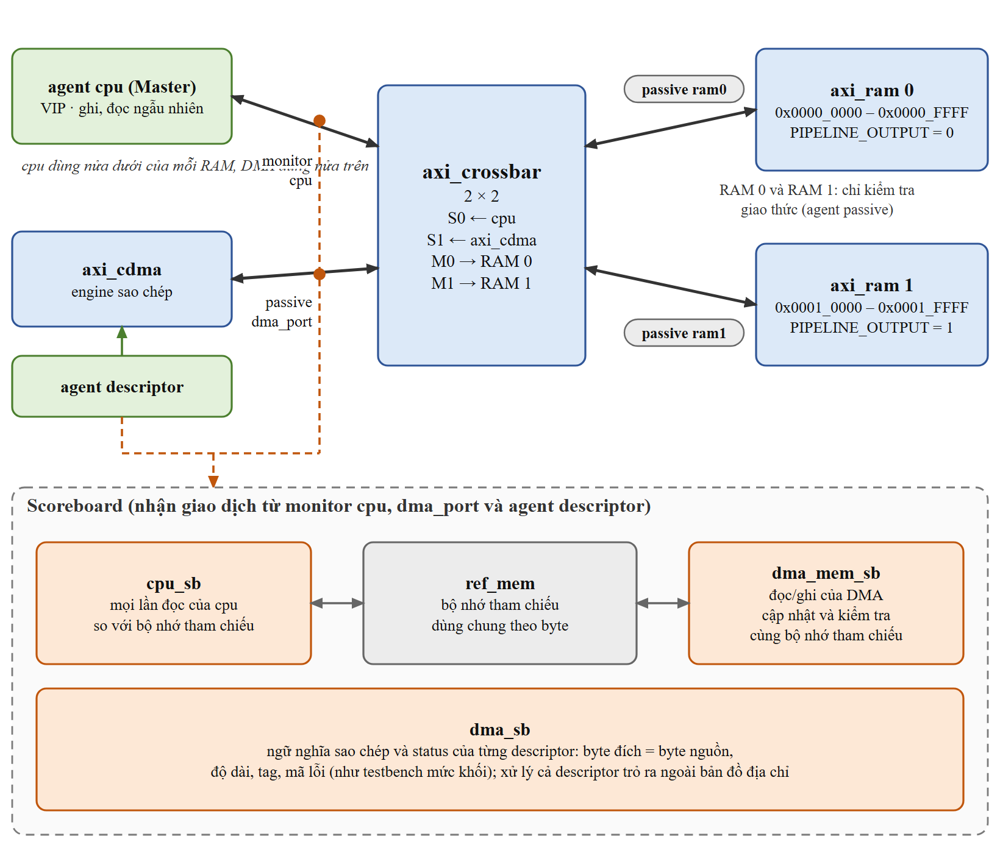

# Môi trường kiểm chứng UVM cho AXI4-Full Interconnect, RAM và DMA

Đồ án xây dựng một **VIP AXI4-Full dùng lại được** (`axi4_vip/`) bằng UVM 1.2, rồi dùng nó để kiểm chứng
bộ nhớ, bộ kết nối (crossbar) và ba engine DMA của thư viện mã nguồn mở
[verilog-axi](https://github.com/alexforencich/verilog-axi) (Alex Forencich), từ mức khối tới mức hệ thống.

* Môi trường **tự kiểm tra hoàn toàn**: mỗi test có scoreboard, bộ kiểm tra giao thức và assertion.
* Phần lớn test là **ngẫu nhiên có ràng buộc, chạy nhiều seed**; các góc khó có test directed riêng.
* Độ phủ được báo cáo **trung thực**: luôn đưa cả số thô lẫn số sau loại trừ, mỗi mục loại trừ đều có lý do.
* Môi trường tìm ra **12 lỗi / giới hạn** của thiết kế, mỗi cái có test tái hiện (xem [Lỗi tìm được](#lỗi-tìm-được)).
* Toàn bộ test cũng được chạy trên **mã gốc nguyên bản** của thư viện để biết mã gốc qua được bao nhiêu test
  (xem [Chạy trên mã gốc](#chạy-trên-mã-gốc-nguyên-bản)).

Công cụ: **QuestaSim 10.7c**, **UVM 1.2**, SystemVerilog, PowerShell 7.



## Kết quả

Số liệu của lần regression cuối. Các con số này được sinh tự động vào `reports/`, không gõ tay.

| | |
|---|---|
| Số lần mô phỏng của regression chính | 340 (50 test khác nhau) |
| Kết quả | **326 PASS, 0 FAIL, 14 XFAIL, 0 XPASS** |
| Phép so sánh của scoreboard (các lần PASS) | khoảng 12,6 triệu |
| Độ phủ chức năng (mức khối) | 100% ở mọi testbench |
| Lần chạy tham chiếu trên mã gốc | 283 (163 qua, 120 không qua) |

XFAIL là test minh hoạ lỗi của thiết kế: nó **bắt buộc phải fail**; nếu bỗng PASS thì regression báo XPASS và coi là thất bại.

### Độ phủ mã tổng

"Total" là Total Coverage của QuestaSim: trung bình statement, branch, condition, expression, FSM và toggle.

| Nhóm | Không loại trừ | Chỉ loại trừ mục không thể đạt | Thêm mục giới hạn bởi cấu hình |
|---|---|---|---|
| RAM (`axi_ram`) | 94,95% | 100,00% | 100,00% |
| Interconnect (8 khối của `axi_crossbar`) | 94,39% | 99,77% | 100,00% |
| DMA (`axi_dma_rd`, `axi_dma_wr`, `axi_cdma`) | 96,03% | 98,84% | 100,00% |



Cách đọc bảng:

* **Cột 1** là số thô của regression.
* **Cột 2** bỏ các mục không kích thích nào đạt được (biến vòng lặp `integer`, tín hiệu gán hằng, mã chỉ chạy lúc
  elaboration, hàng điều kiện mâu thuẫn về cấu trúc...).
* **Cột 3** bỏ thêm các mục chỉ không đạt được vì cấu hình đã kiểm chứng (bus 32 bit, 3 vùng địa chỉ mỗi slave).
* Lệnh loại trừ nằm ở `cov/exclusions/*.do`, **mỗi lệnh kèm lý do**.

> **Lưu ý quan trọng:** số coverage và regression chính được đo trên RTL **đã bật 7 bản sửa tuỳ chọn**
> (xem [Về RTL](#về-rtl-và-các-bản-sửa-tuỳ-chọn)). Độ phủ **chưa** được đo trên mã gốc nguyên bản.

Chi tiết: [`reports/coverage_summary.md`](reports/coverage_summary.md),
[`reports/regression_summary.md`](reports/regression_summary.md).

### Chạy trên mã gốc nguyên bản

Mọi test chính được chạy lại, cùng seed và cấu hình build, trên RTL không có bản sửa nào: crossbar build không định nghĩa
macro sửa lỗi nào (8 file giống hệt mã gốc); `axi_ram`, `axi_dma_rd`, `axi_dma_wr`, `axi_cdma` là file nguyên vẹn trong
`upstream_ref/`. Kết quả ghi là `ORIG-PASS` / `ORIG-FAIL`, **không** tính vào regression chính.

| Thiết kế (mã gốc) | Build | Số lần chạy | Qua | Không qua |
|---|---|---|---|---|
| `axi_ram` | `ram_up` | 43 | 42 | 1 (burst WRAP, giới hạn đã công bố) |
| `axi_crossbar`, không bật bản sửa nào | `xbar_orig` | 73 | 5 | 68 |
| `axi_dma_rd` | `dma_rd_up` | 53 | 53 | 0 |
| `axi_dma_wr` | `dma_wr_up` | 58 | 49 | 9 (DMAWR-01) |
| `axi_cdma` | `cdma_up` | 56 | 14 | 42 (CDMA-01) |

Hiểu đúng: trên mã gốc, hầu như mọi test ngẫu nhiên của crossbar và của `axi_cdma` đều vấp các lỗi đã biết; đó là lý do
regression chính chạy với các bản sửa tuỳ chọn bật (nếu không, các lỗi đã biết che mất mọi vấn đề khác).
Từng test không qua và dấu hiệu trong log: báo cáo đồ án, mục 7.2.

## Cấu trúc

| Thư mục | Nội dung |
|---|---|
| `axi4_vip/` | VIP AXI4-Full: agent master / slave / passive, monitor + bộ kiểm tra giao thức, coverage, scoreboard bộ nhớ, thư viện sequence |
| `dut/` | RTL được kiểm chứng (`dut/axi_ram/`: RAM và crossbar; `dut/dma/`: ba engine DMA) |
| `tb/common/` | clock/reset, lớp test cơ sở (in `TEST_INFO` / `TEST SUMMARY`), agent AXI-Stream |
| `tb/tb_vip/` | VIP tự kiểm (master ↔ slave, không RTL) và test âm cho bộ kiểm tra |
| `tb/tb_ram/` | testbench `axi_ram` |
| `tb/tb_xbar/` | testbench `axi_crossbar` (2 master × 3 slave, mô hình giải mã địa chỉ, scoreboard định tuyến, bộ kiểm tra giới hạn) |
| `tb/tb_dma/` | testbench ba engine DMA (agent descriptor, scoreboard DMA) |
| `tb/tb_sys/` | testbench hệ thống: master VIP + `axi_cdma` → `axi_crossbar` → 2 × `axi_ram` |
| `scripts/` | cấu hình testbench / test (`dv_config.ps1`), thư viện, tạo báo cáo coverage / regression / báo cáo đồ án, tạo waveform |
| `cov/exclusions/` | loại trừ coverage, kèm lý do |
| `reports/` | báo cáo sinh tự động (regression, coverage, bằng chứng lỗi) |
| `docs/` | kế hoạch kiểm chứng, danh sách lỗi, hướng dẫn VIP, báo cáo tổng kết, `images/` (sơ đồ và script vẽ) |
| `upstream_ref/` | bản gốc nguyên vẹn của 4 file RTL bị sửa, để chạy trên mã gốc và tái hiện lỗi |

## Yêu cầu

* Windows, QuestaSim 10.7c (kèm thư viện UVM 1.2), PowerShell 7 (`pwsh`).
* Đường dẫn QuestaSim đang đặt cứng ở đầu `scripts/dv_lib.ps1` (`C:\questasim64_10.7c\win64`); sửa biến `$DvQuesta` nếu cài ở chỗ khác.
* `modelsim.ini` ở thư mục gốc ánh xạ thư viện `mtiUvm` sang `uvm-1.2`.
* Python 3 và Microsoft Edge chỉ cần nếu muốn tạo lại sơ đồ hoặc báo cáo Word (xem [Tài liệu](#tài-liệu)).

## Chạy

Mọi lệnh chạy từ thư mục gốc của repo.

Một test (log: `logs/<tb>/<test>__<cfg>__s<seed>.log`):

```powershell
pwsh -File .\run_test.ps1 -Tb ram  -Test axi_ram_random_test -Seed 3
pwsh -File .\run_test.ps1 -Tb xbar -Test xbar_random_test -Cfg open -Seed 1 -Cov
pwsh -File .\run_test.ps1 -Tb dma_wr -Test dma_random_test -Plus '+NUM_DESC=200','+BP_PCT=20'
```

Toàn bộ regression có coverage (gồm cả các lần chạy trên mã gốc), rồi báo cáo (cổng 98%):

```powershell
pwsh -File .\regress.ps1
pwsh -File .\scripts\cov_report.ps1 -MinTotal 98
pwsh -File .\scripts\regression_summary.ps1
pwsh -File .\scripts\known_issues_evidence.ps1
```

Một phần regression:

```powershell
pwsh -File .\regress.ps1 -Tb xbar,sys
pwsh -File .\regress.ps1 -Tb dma_wr -Filter '*random*' -NoCov
pwsh -File .\regress.ps1 -SeedScale 3
```

Tên testbench, cấu hình build (tham số DUT) và danh sách test nằm trong `scripts/dv_config.ps1`.
Regression đầy đủ (623 lần mô phỏng) chạy khoảng 17 phút với 6 tiến trình song song (`-Jobs 6`) trên máy 16 luồng logic.

Xem waveform của một test (regression không ghi waveform; script này build một bản có thể quan sát tín hiệu):

```powershell
pwsh -File .\scripts\make_wave.ps1 -Tb ram -Test axi_ram_smoke_test
vsim -modelsimini modelsim.ini -view build/wave/axi_ram_smoke_test__default__s1.wlf -do docs/images/waves/fig_2_3_write_burst.do
```

## Log của một test có gì

Mỗi log mở đầu bằng khối `TEST_INFO` và kết thúc bằng `TEST SUMMARY`, không chỉ có bảng tổng kết của UVM:

```
TEST      : dma_random_test
DUT       : axi_cdma (AXI_DATA_WIDTH=32 AXI_ADDR_WIDTH=32 AXI_MAX_BURST_LEN=16 ENABLE_UNALIGNED=1 ...)
INTENT    : random transfers of every length class and alignment are correct under random backpressure ...
STIMULUS  : 60 random descriptors: lengths around word/burst/4KB boundaries ...
CHECKING  : dma_scoreboard: per descriptor, stream bytes vs AXI bytes in order, byte count, ...
SEED      : 1
...
[DMA_DESC] #1 accepted: descriptor rd_addr=57941031 wr_addr=a2a705e3 len=2 tag=e5 ...
[AXI_TXN] mem: RD id=0 addr=57941031 len=0 size=2 INCR ... rresp=OKAY stall(addr/data/resp)=1/0/0
...
checks performed : 21506 (minimum required 1)
TEST_RESULT: PASSED test=dma_random_test seed=1
```

Một lần chạy chỉ tính PASS khi có `TEST_RESULT: PASSED`, `UVM_ERROR : 0`, `UVM_FATAL : 0`, trình mô phỏng không báo lỗi và
số phép so sánh không nhỏ hơn ngưỡng tối thiểu của test (test không so sánh gì thì fail).

## AXI4 VIP

`axi4_vip/` không phụ thuộc thiết kế nào; cả năm testbench dùng cùng một bộ mã, chỉ khác cấu hình.

* **Master**: sequencer + driver có pipeline (nhiều giao dịch đang chờ), trễ và backpressure ngẫu nhiên.
* **Slave**: driver phản ứng có bộ nhớ riêng; điều khiển được READY, trễ, đổi thứ tự và xen kẽ giữa các ID, đáp ứng lỗi theo vùng.
* **Passive**: chỉ monitor, bộ kiểm tra giao thức và coverage, để gắn vào bus nội bộ.
* Kiểm tra giao thức ở mức tín hiệu (SVA trong interface) và mức giao dịch (monitor); đặt giá trị ngẫu nhiên lên tín hiệu khi VALID thấp.
* Slave có thể cố ý phát lỗi giao thức (RLAST sớm, BID sai, không đáp ứng) để chứng minh bộ kiểm tra bắt được lỗi.

Hướng dẫn dùng lại VIP cho thiết kế khác: [`docs/VIP_USER_GUIDE.md`](docs/VIP_USER_GUIDE.md).

Testbench của crossbar và testbench hệ thống:





## Lỗi tìm được

Đối chiếu với nhánh `master` của kho gốc: 8 file crossbar **giống hệt** mã gốc; `axi_ram.v`, `axi_dma_rd.v`,
`axi_dma_wr.v`, `axi_cdma.v` đã bị chỉnh sửa trong project. Bảng phân loại độ chắc chắn đầy đủ ở
[`docs/KNOWN_ISSUES.md`](docs/KNOWN_ISSUES.md); bằng chứng lấy từ log ở `reports/known_issues_evidence.txt`.

| Mã | Khối | Tóm tắt | Tình trạng |
|---|---|---|---|
| RAM-01 | `axi_ram` | Burst WRAP bị xử lý như INCR | Giới hạn đã công bố trong tài liệu gốc |
| XBAR-01 | crossbar | Đáp ứng DECERR phát trước khi yêu cầu được nhận xong | Đã có người khác báo trên kho gốc |
| XBAR-02 | crossbar | Master bị khoá sau DECERR | Đã có người khác báo trên kho gốc |
| XBAR-03 | crossbar | DECERR sai thứ tự so với đáp ứng cùng ID (ở mức hệ thống: DMA báo lỗi nhầm descriptor) | Chỉ đồ án này tìm ra |
| XBAR-04 | crossbar | Slave xen kẽ dữ liệu đọc làm nhịp tới sai master | Tính năng chưa hỗ trợ, tác giả đã ghi nhận |
| XBAR-05 | crossbar | Mất nhịp ghi đầu tiên sau một lần ghi bị DECERR | Chỉ đồ án này tìm ra |
| XBAR-06 | crossbar | Tham số `M_*_REG_TYPE` không được truyền xuống `axi_crossbar_wr/rd` | Đã có người khác báo trên kho gốc |
| XBAR-07 | crossbar | Đáp ứng tới sai master khi kênh đáp ứng phía master có thanh ghi (bị XBAR-06 che) | Chỉ đồ án này tìm ra |
| XBAR-08 | crossbar | Giới hạn `M_ISSUE` bị vượt; với giá trị 1 thì mất hẳn | Chỉ đồ án này tìm ra |
| CDMA-01 | `axi_cdma` | Mất một nhịp đọc khi nguồn và đích lệch byte khác nhau | Tái hiện được trên file gốc nguyên vẹn |
| DMAWR-01 | `axi_dma_wr` | Nuốt nhịp đầu của gói kế tiếp sau một gói ngắn bị chia | Tái hiện được trên file gốc nguyên vẹn |
| DMA-01 | `axi_dma_wr` | Ngõ vào `abort` không có tác dụng | Giới hạn; mã gốc cũng vậy |

Với các lỗi "chỉ đồ án này tìm ra" và hai lỗi DMA, bằng chứng là: test fail trên RTL chưa sửa, nguyên nhân chỉ ra được ở dòng RTL
cụ thể, và bản sửa làm test PASS. **Chưa có xác nhận độc lập** từ tác giả thư viện.

## Về RTL và các bản sửa tuỳ chọn

Bảy lỗi có bản sửa đặt trong khối `` `ifdef ``; **không định nghĩa macro thì RTL giữ nguyên hành vi gốc**.
Regression chính và số coverage được đo với các macro này bật (xem `scripts/dv_config.ps1`).

| Macro | Lỗi | File |
|---|---|---|
| `AXI_CROSSBAR_DECERR_CPL_FIX` | XBAR-02 | `axi_crossbar_wr.v`, `axi_crossbar_rd.v` |
| `AXI_CROSSBAR_WREADY_GATE_FIX` | XBAR-05 | `axi_crossbar_wr.v` |
| `AXI_CROSSBAR_M_REG_TYPE_FIX` | XBAR-06 | `axi_crossbar.v` |
| `AXI_CROSSBAR_RESP_SELECT_FIX` | XBAR-07 | `axi_crossbar_wr.v`, `axi_crossbar_rd.v` |
| `AXI_CROSSBAR_ISSUE_LIMIT_FIX` | XBAR-08 | `axi_crossbar_wr.v`, `axi_crossbar_rd.v` |
| `AXI_CDMA_RREADY_FIX` | CDMA-01 | `axi_cdma.v` |
| `AXI_DMA_WR_TREADY_FIX` | DMAWR-01 | `axi_dma_wr.v` |

RTL gốc và các bản sửa một phần được build riêng (`xbar_orig`, `xbar_fix02`, `xbar_fix06`, `xbar_fix07`, `dma_wr_orig`,
`cdma_orig`) để chạy các test minh hoạ lỗi (đánh dấu XFAIL). Năm build `ram_up`, `dma_rd_up`, `dma_wr_up`, `cdma_up`
(và `xbar_orig`) chạy trên RTL gốc để lấy kết quả ở mục [Chạy trên mã gốc](#chạy-trên-mã-gốc-nguyên-bản).


## Phạm vi và hạn chế

* Chỉ kiểm chứng bus dữ liệu 32 bit; crossbar chỉ một hình học (2 master × 3 slave, 3 vùng địa chỉ mỗi slave) với hai biến thể kết nối.
* Độ phủ mã chưa được đo trên mã gốc nguyên bản (các lần chạy trên mã gốc chỉ ghi nhận qua / không qua).
* Ba vấn đề của crossbar chưa có bản sửa (XBAR-01, 03, 04); các test thông thường né hoặc miễn trừ có đếm các tình huống này.
* `S_ACCEPT` chỉ kiểm tra được với biên nới theo độ sâu register slice; `S_THREADS` không được kiểm tra trực tiếp.
* Coverage thu với thiết lập mặc định; tuỳ chọn `-coverdeglitch` làm QuestaSim 10.7c crash trên thiết kế này nên không dùng.
* Mục loại trừ gắn nhãn `CONFIG-LIMITED` chỉ không đạt được trong các cấu hình đã kiểm chứng, không phải không thể đạt về nguyên tắc.
* VIP chưa hỗ trợ truy cập exclusive, AXI3 và AXI4-Lite.

## Tài liệu

| File | Nội dung |
|---|---|
| [`docs/BAO_CAO_TONG_KET_DO_AN.docx`](docs/BAO_CAO_TONG_KET_DO_AN.docx) | Báo cáo tổng kết đồ án (7 mục + tài liệu tham khảo) |
| [`docs/VERIFICATION_PLAN.md`](docs/VERIFICATION_PLAN.md) | Chiến lược, cấu hình build, bảng tính năng → test, tiêu chí hoàn thành |
| [`docs/KNOWN_ISSUES.md`](docs/KNOWN_ISSUES.md) | Lỗi và giới hạn của DUT, test tái hiện, bản sửa tuỳ chọn, đối chiếu và chạy trên mã gốc |
| [`docs/VIP_USER_GUIDE.md`](docs/VIP_USER_GUIDE.md) | Dùng lại `axi4_vip` cho thiết kế khác |
| `docs/images/` | Sơ đồ của báo cáo (PNG). Nguồn vẽ: `docs/images/src/` (`python figs.py`, rồi `render.ps1`); waveform: `docs/images/waves/*.do` |

Báo cáo Word được tạo bằng `python scripts/make_report.py` từ các file trong `reports/` và `docs/images/` (không gõ tay số liệu).
Ba hình waveform trong báo cáo (Hình 2.2 – 2.4) được chụp từ QuestaSim bằng các file `.do` trong `docs/images/waves/` và lưu tại `docs/images/fig_2_2.png`, `fig_2_3.png`, `fig_2_4.png`.

## licence

* RTL trong `dut/` và `upstream_ref/` bắt nguồn từ [verilog-axi](https://github.com/alexforencich/verilog-axi),
  Copyright (c) Alex Forencich, giấy phép MIT (xem tiêu đề của từng file). Kho gốc đã ngừng bảo trì và được thay bằng
  [taxi](https://github.com/fpganinja/taxi).
